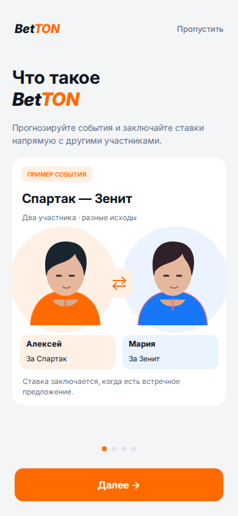
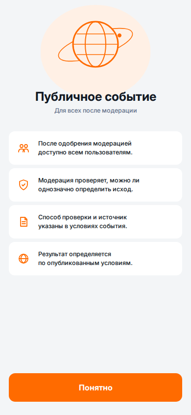
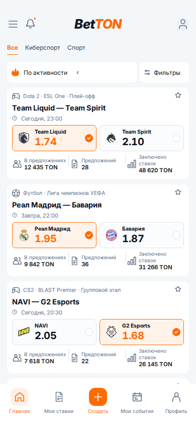
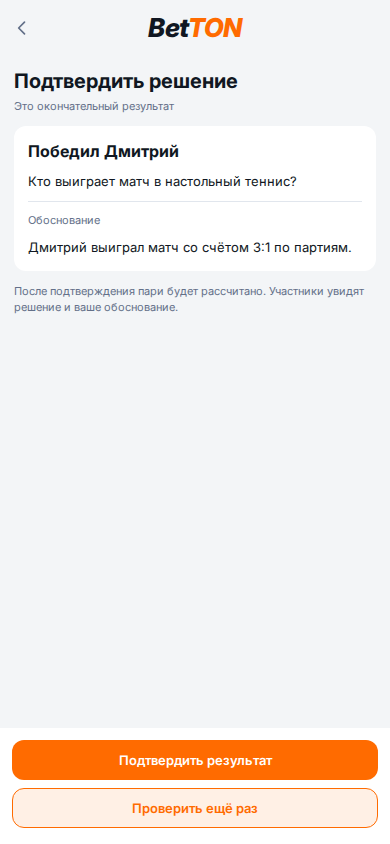
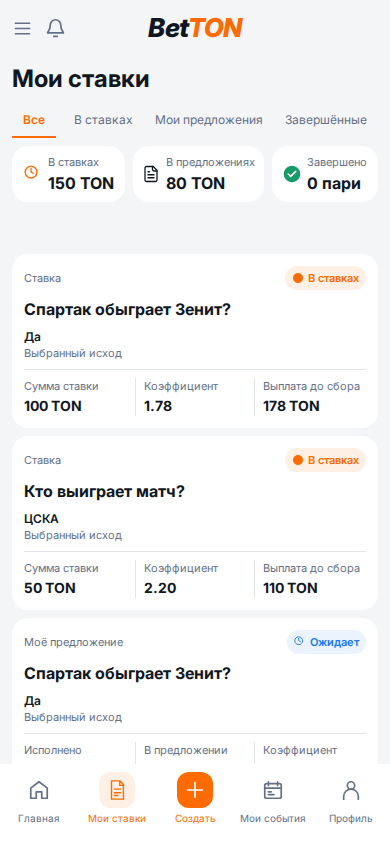

# Browser evidence — 29.10.2026

These are actual React screenshots from isolated, explicitly labelled fixtures,
not real user balances or live event results. They are documentation only and are
never imported into the application. Viewport: 390 × 844, light, Russian.

The automated report covers 84 captures at widths 320, 390 and 430. It checks
runtime errors, horizontal overflow and displayed images; it does not prove full
pixel-level acceptance. See [remaining work and contract gaps](../VISUAL_V1_IMPLEMENTATION_20261029.md).

| Surface | Actual React screenshot |
| --- | --- |
| Onboarding |  |
| Event type details |  |
| Feed |  |
| Creator confirmation |  |
| Portfolio with API-compatible fixture fields |  |

`report.json` records each capture's source frame, image/overflow checks and the
creator-confirmation/legacy checks. Run `frontend/scripts/verify-visual-v1.mjs`
from `frontend` to reproduce the fixture entry points.
