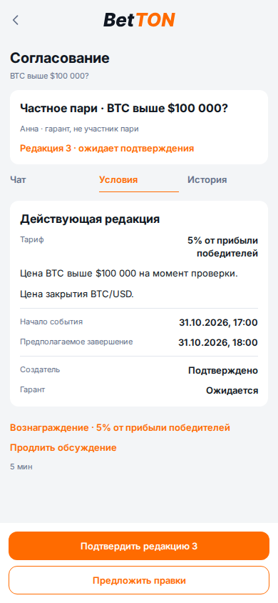
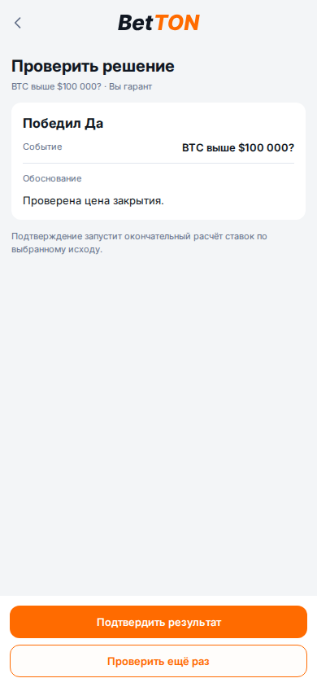
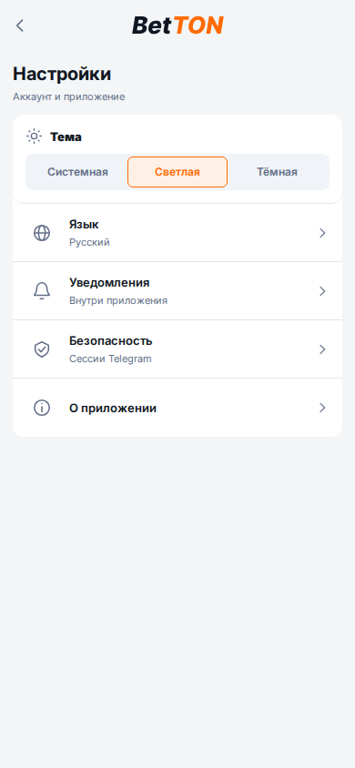
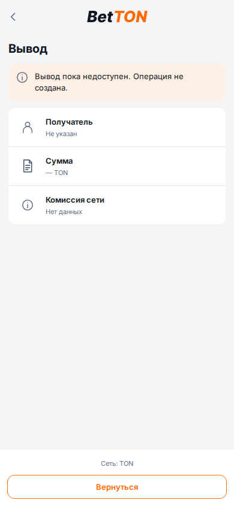

# Browser evidence — 30.10.2026

Isolated React fixtures; no live balances or results. Russian, light, 390×844.
Screenshots are documentation assets and are never imported into the application.

| Surface | Screenshot |
| --- | --- |
| Guarantor terms |  |
| Guarantor final confirmation |  |
| Settings |  |
| Wallet integration unavailable |  |

`workflows-report.json` records 23 captures at 320/390/430 px. The harness also
checks stale revision blocking, separate final confirmation, retained reason on
server failure, theme handoff and keyboard focus restoration, actual network
callback and absence of fabricated on-chain balance. Reproduce from `frontend`
with `node scripts/verify-workflows-v1.mjs`; optional `CHROMIUM_EXECUTABLE_PATH`.

Chat and moderation have separate reproducible harnesses:
`verify-chat-v1.mjs` and `verify-moderation-v1.mjs`. These checks do not prove full
pixel equality or a real Telegram WebView/wallet/PostgreSQL integration.
See [scope and remaining work](../../VISUAL_V1_IMPLEMENTATION_20261029.md).
